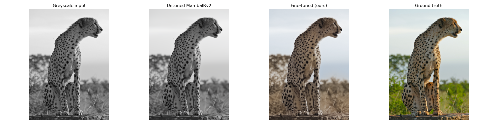
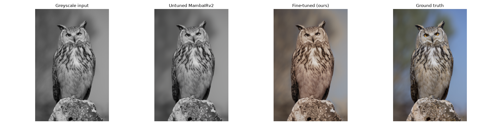
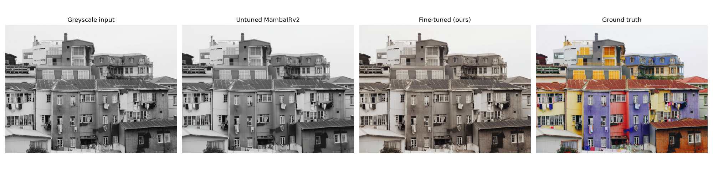
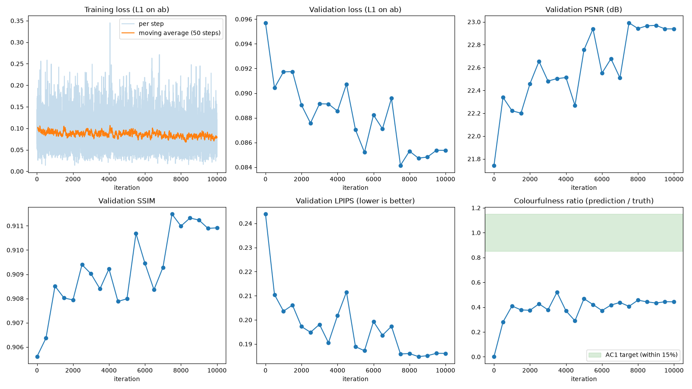
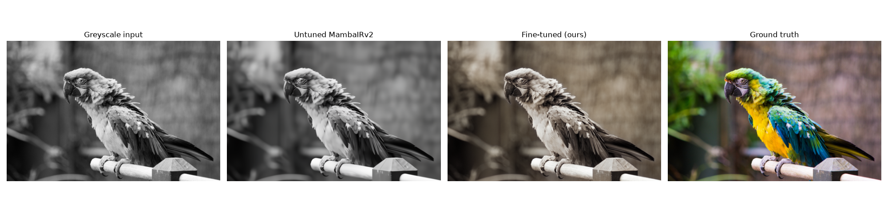
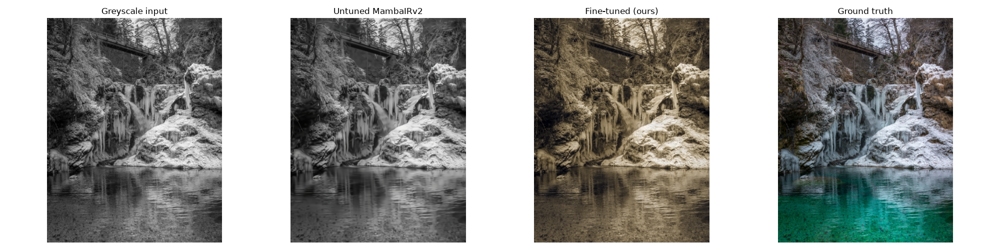
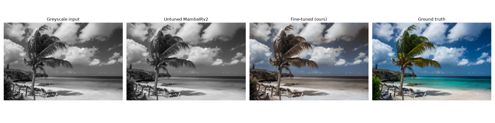

## Image Colourisation Using MambaIRv2: State Space Restoration

User: People wanting to restore old greyscale images to colourful images. (museums, libraries)

Purpose: Determine whether fine tuning the MambaIRv2 can produce a clear and realistic colour output from greyscale images efficiently.

Dilemma: Greyscale images cannot fully recover the true colour, therefore plausibility must be demonstrated though several benchmarks, and not only on pixel accuracy.

AC1. Mean colourfulness within 15% of ground truth
AC2. LPIPS lower than frozen pretrained MambaIRv2
AC3. SSIM no lower than frozen pretrained MambaIRv2
AC4. Colour bleeding in no more than 1 of 20 randomly chosen outputs
AC5. Peak VRAM < 15GB on GPU and runtime lower than 1 second per image

The model will be fine-tuned on the DIV2K dataset, a dataset made up of 800 colourful RGB images, with all images converted from RGB to Lab colour space. The baseline is a frozen pretrained MambaIRv2 colour denoising model, obtained from the official HuggingFace repository. The ab predicted channels are evaluated against the ground truth using colourfulness, LPIPS, and SSIM (with PSNR for reference) on the DIV2K validation set.

Difficulty Band: Hard

Course Concepts: CNNs can only see a limited, fixed area of an image at once, while Vision Transformers use full self-attention, which gets expensive fast because its cost grows quadratically with image size. MambaIRv2 uses window-based self-attention to capture fine local detail, and a state space module that runs in linear time to understand the image as a whole. 

Risks:
1.	Colour bleeding on sharp edges due to low level of detail
2.	Colour desaturation (dull or brownish tint) due to model averaging colours to produce consistent low loss results
3.	Chromatic hallucinations due to the model outputting confident but incorrect colours
4.  Context dependance (model refering to similar or neighbouring regions)

---

Model Dependancies:
- Python (3.11.17)
- torch (2.4.0, CUDA 12.1 build)
- torchvision (0.19.0)
- mamba_ssm (2.2.5)
- causal_conv1d (1.5.2)
- transformers (4.44.2)
- numpy (< 2)
- einops
- timm
- opencv-python-headless
- scikit-image
- matplotlib
- lpips

CUDA GPU required for MambaIRv2

Results are highly reproducable as the train/vaildation split is seeded, as well as the crops and flips within the training images are seeded. GPU calculations of the Mamba kernals may differ slightly, so training the model again would yield very similar results.

---

Each example contains the input image (greyscale far left), frozen pretrained MambaIRv2 output baseline (second image), trained fine-tuned MambaIRv2 Colouriser output (thrid image), and ground truth output (far right image)

Visual plots of the models training is show below, training loss is top left, validation loss L1 is top middle, and the other measured metrics are the remaining graphs. 

At about 8000 iterations, all metrics plateu, showing that longer training only would make small improvments. 

---

### Preprocessing

Origionally, the pretrained MambaIRv2 model takes a RGB image as an imput. I have converted the format of the fine-tuned model to accept Lab format, where the L channel is the greyscale input, and the a and b channel is the models prediction based off of the L channel input of the colours in the image.

The DIV2K dataset is already split up into training (800 images), and validation (100 images). The presplit validation set was used as the testing set, while the training set was split again to create a validation set, which consists of 100 images, leaving the reamaining 700 for training. The 700 images for training has been augmented, there is a 50% chance for a image to be flipped horizontally, and another independent 50% chance that it is flipped vertically. Each training image is randomly cropped, 50 times per image per epoch. It is leakage free since it is split as a whole image using a fixed seed.

DIV2K presplit dataset: https://data.vision.ee.ethz.ch/cvl/DIV2K/

---

## Investigation of the Open-Dilema

### Quantitative Benchmarking of Baseline vs Fine-Tuned
**PSNR**
PSNR shows us how distorted the reconstructed image is, a higher value indicates a less distorted reconstruction
- 21.98 vs 23.15

**SSIM**
SSIM is the structural similarity index, it measures the percived quality and similarity between the output to the ground truth. It stronger represents the human visual perception as it does not calculate it from raw pixel differences. A value closer to 1 indicates an accurate reconstruction.
- 0.8787 vs 0.9186

**LPIPS**
LPIPS is the learned perceptual image patch similarity, similarly to SSIM is represents the human visual perception. LPIPS is trained to extract high level features, while SSIM extracts structural. A low value of LPIPS results in an accurate reconstruction.
- 0.2748 vs 0.1808

**Colourfullness**
The definition of colourfullenss for this model has been extracted from teh following paper: https://www.researchgate.net/publication/243135534_Measuring_colorfulness_in_natural_images. It defines how vibrant the colours used in the output, it is a direct measure of the colour desaturation risk evaluated above. The colourfullness is measured as the colourfullness of the model output divided by the colourfullness of the ground truth. Therefore, a low value means the model has colour desaturation, and a value of 1 means the model output is as colourfull as the ground truth.
- 0.015 vs 0.450

---

### Resource Profiling
**Paramters:** 22,653,272 parameters

**Peak VRAM:** 13.3GB during training, and 5.86 GB during inference

**Inference Time:** The model takes 2.279 seconds/image

**Training Speed:** The models training took 8.52 hours (8 hours and 31 mins)

---

### Error Autopsies

**1. Colour desaturation**

Colour desaturation was the largest issue when fine tuning the MambaIRv2. Colour desaturation comes from when the model produces brownish/dull tinted outputs. The model was trained a L1 loss on the ab channels. To minimise this loss, the model produced the average values for colour (dull/brown), since one value on the greyscale will relate to many colours. When there are vibrant colours on the input image, the model will not be able to reproduce the vibrant colours, and defult to a average dull colour, seen below.

To help midigate colour desaturation, I added an additional loss term called mean-chroma loss. Mean-chroma penalised the difference between colour strength of the ground truth and output. This assisted in experimental testing as it increase the colourfullness metric from 0.296 to 0.464. The experimental testing was conducted on 10 times less training that the main training. This large increase in colourfullness was a reduction in colour desaturation, however imposes great risks during longer training with chromatic hallucinations. The visual difference from the chroma loss to only L1 loss was not noticable human vision, and not worth the added risk. The top row of images was the results after the only L1 loss experimental training, the second row is hte results of the L1 loss and chroma loss.

**L1 loss only**

**L1 loss and Mean-chroma loss**

Another method used to midigate the severity of Colour desaturation was raising the pretrained body's learning rate from 2e-5 to 1e-4. This allowed the body, where context reasoning takes place to adapt to colourisation rather than retaining denoising atttibutions. During experiments, it increase the colourfullness by 21%, for only a small LPIPS cost. Additionally, the model was still learning and adapting at 1000 iterations. This change in learning rate was implemented to the final model.

**2. Context Dependance**

The MambaIRv2 model makes decisions about a region based off similar region in the full image, and neighbouring regions. This allows the model to accuratly predict colours of plain, commonly seen regions. Most notibly the sky (a smooth region at the top of the image). In the image below, the model can accurately determine what the greyscale sky and clouds would look like in colour. However due to its complexity cannot infer accurate colours for the palm tree, beach, and chairs.

**3. Slow Inference**

The target inference time was 1s per image, the model is capable of only 2.3s per 512-pixel image. The model I used doesn't shrink the image to make computing quick, the full resolution image is used  by all 36 blocks. Since the cost grows with the number of pixels, not downsizing the image results in heavy computations throughout the model. To prevent this, the model could colourise the image a downscaled image, and only upscale using the ab channels.

---

## Reccomendation

The fined-tuned model can be used as a assistive tool to be used in conjuction of other tools. The model is able to consistantly produce plausable, artifact free colourisations of greyscale images better than the untuned model. It is able to retain the ground truth lightness, and image structure. It is best suited as a first pass, where either a higher complexity or curator can implement plausable vibrant colours, as the fine tuned model can produce 40% of the origional colourfullness.

## Trade-Off

- Colourfullness vs accuracy

In order to produce colourful outputs, the model has to drop accuracy. THis was seen when adding the mean-chroma loss, the LPIPS increased from 0.1940 to 0.1975 on a quick training run

- Decrease inference time vs colour detail

Inference could be made faster by predicting colour at a lower resolution. Downscale the L channel, and predict the ab channels at the smaller size. Upsample only the ab channels and combine them with the original full-resolution L. Halving the image's width and height would reduce computation roughly four times.

---

## Artificial Intelligence Usage Discloure

Network Structures Used from: https://github.com/csguoh/MambaIR/blob/main/options/test/mambairv2/test_MambaIRv2_ColorDN_level15.yml

- GitHub CoPilot was used for autocomplete
- Claude Opus 5.5 was used for metric plotting, data cropping, and assitstance writing main(), error and debugging help
- Claude Opus 5.5 was used for experimental mean-chroma loss implementation, and design of LabColourisor()
- Code was isolated and tested seperatley
